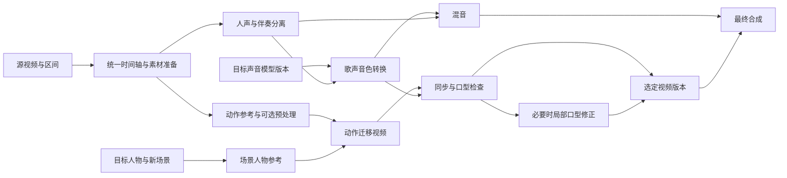

# T18：唱跳换人、换音色、换场景——分阶段计划

最新进展：用户已选 B 组声音，主项目 `42c2fdbf` 的准备、分轨、换声、混音与普通舞台服装参考图均真实完成，动作视频正在主 GPU 队列运行；人物为用户指定的“天台晚风·虚构成年女主”。新增原片/成片同步对照与有效参数展示。完整预览、实际播放与质量审阅仍未完成，详见 `data/t25-main-performance-draft-20261021/README.md`。下文测试数量和样片问题保留各自历史时点。

日期：2026-10-21。状态：**实施中**。已产出真实换人、换场景、换歌声的10秒技术样片（160帧、16fps、480×832），但开头约1秒未保持全身，视觉验收未通过；用户已明确反馈音色不够像，需要调整，口型尚未验收。源片自身在0.05秒突变至右缘，生成仍未保住第0帧的居中姿态，详细逐帧证据继续保留。本轮已补完整短视频预览与对应审批，S07已接入只读分段规划；真实素材20秒规划与桌面/手机界面检查已有记录，长视频执行、连续性和真实长样片仍未完成。本轮完整质量门为1473项Python通过、3项跳过、前端44项通过，不能代替真实音色/视频质量验收。详见 [实施与验收记录](IMPLEMENTATION.md)。

## 已确定的目标

用户上传单人唱跳视频，系统保留参考舞蹈、歌曲与演唱节奏，替换为指定人物、指定歌声音色，并生成新场景。默认保留原歌词、旋律、伴奏和近似原镜头视角；先生成明确区间内、最多10秒的完整唱跳视频，用户观看后再审批。后续长片仍需完成S07执行与验收，分段计划不能代替生成结果。预览实际帧数和长度受冻结工作流约束，不强行拉伸模型输出凑时长。

输入为参考视频、目标人物图片、目标声音样本或可用声音模型、新场景描述。沿用现有角色/声音库的授权状态。唱歌采用歌声音色转换，原视频的演员不是自动创建的目标身份。首版暂不加入多人轮唱、重新作曲、改歌词、任意大幅度运镜等额外功能。

## 分阶段安排

| 阶段 | 工作 | 阶段出口 | 依赖 |
| --- | --- | --- | --- |
| [S00](S00-scope-and-reliability.md) | 规格对齐、基线、阻塞问题修复 | 新模式规格明确，失败/取消/图片校验可靠 | 无 |
| [S01](S01-real-model-proof.md) | 真实模型短样片验证 | 得到可接受的新人物、新音色、新场景唱跳短片及复现记录 | S00 的范围定义；可与缺陷修复并行 |
| [S02](S02-state-and-preparation.md) | 数据模型、统一时间轴、素材准备 | 新模式可入库，旧项目兼容，音视频与片段定位可复现 | S01 选型结论；S00 |
| [S03](S03-singing-voice.md) | 声音模型准备、人声分离、歌声转换 | 从歌曲与目标声音得到可试听的换声人声与混音 | S02 |
| [S04](S04-motion-and-scene.md) | 人物、动作迁移、新场景生成 | 同动作的新人物/新场景无声视频可稳定生成 | S02，可与 S03 开发并行 |
| [S05](S05-sync-and-export.md) | 音画同步、可选口型修正、合成 | 第一版完整唱跳 MP4 达标，增量重建正确 | S03、S04 |
| [S06](S06-web-and-director.md) | 网页操作与导演编排 | 上传到预览、修改、续跑、导出可全程操作 | S05；交互原型可提前 |
| [S07](S07-long-video-and-release.md) | 长视频、连续性、恢复、发布验收 | 较长参考视频可分段完成，失败恢复和版本回退可靠 | S06 |

执行顺序：`S00范围 → S01 → S02 → (S03 + S04) → S05 → S06 → S07`。
S00 的缺陷修复与 S01 的隔离模型验证可以并行，但正式自动流程必须通过 S00。
开发可并行不代表同一张 GPU 同时运行多个大模型；沿用共享 GPU lane 的串行约束。

## 里程碑

- **M1 / 技术可行：S01。** 有真实生成样片，能评价动作、人物、音色和场景，而不是只有假接口测试。
- **M2 / 后端闭环：S05。** 短视频可经过持久化队列输出，支持重试、取消、缓存和回退。
- **M3 / 可操作版本：S06。** 用户可在网页完成试听、完整短视频预览、观看审批和成片操作；场景图与试听不能代替视频审批。
- **M4 / 长视频版本：S07。** 分段衔接、时间轴和恢复行为通过长片验收。

## 当前入口与审批

以下路径均位于 `/projects/{id}/performance` 下，HTTP与导演共用服务。

| 入口 | 当前行为 | 审批与范围 |
| --- | --- | --- |
| `POST /prepare` | 仅准备参考画面、音频及时间映射 | 不调用生成模型 |
| `POST /preview` | 场景人物参考图、换声人声与混音 | 需输入审批；没有动作视频或最终MP4 |
| `POST /video-preview` | 生成动作、换声、同步、可选口型和最终MP4 | 需输入审批及模型/工作流就绪；当前保存区间必须≤10秒，不自动缩短 |
| `POST /generate` | 处理当前已审批区间，可复用有效结果 | 需看过真实视频后的`performance_preview`审批；不会自动扩展成全长 |
| `POST /segment-plan` | 按冻结原生时钟提出较长区间的分段计划 | 只读；`execution_available=false`，不排任务或修改已保存预览 |

`performance_preview`审批绑定当前场景、歌声、动作、同步、混音、成片及启用的口型版本，并要求可查看的最终视频路径；只看场景图或听声音不能审批。`performance_final`单独记录成片审阅。S07目前仅有规划能力，30–60秒真实生成、跨段衔接和完整歌曲均未验收。

## 当前工程可复用的部分

- `state/`：项目、资产、不可变版本和依赖关系；需要扩展节点类型与 SQLite 升级流程。
- `jobs/`：持久化队列、GPU/API/CPU lanes、进程隔离与恢复。
- `assets/media.py`：已有 FFmpeg 拆分与可选 Demucs 人声/伴奏分离入口。
- `backends/comfyui.py`、`backends/workflows.py`：提交、轮询和下载；需要真实动作迁移工作流。
- `engine/rebuild.py`、`executors/handlers.py`：按依赖重建；现有任务类型、授权、审阅检查有硬编码，须系统扩展。
- `director/`、`api/`、Vue 工作室：对话、素材选择、任务状态、预览与设置。

## 建议的处理图

以下是实现采用的处理边界；各节点能否实际生成仍取决于对应模型就绪和阶段验收。



若所选工作流直接读取动作视频，不额外制造一套它不消费的姿态文件。歌曲、动作轨、目标身份和场景分别保存版本。开启音频驱动口型修正时，该修正必须依赖转换后人声；不能承诺换声音永远不重做口型。

## 增量重建规则

| 修改 | 应重建 | 可复用 |
| --- | --- | --- |
| 伴奏音量、混音响度 | 混音、最终合成 | 人声转换、动作视频、口型（时序未变） |
| 目标音色或声音模型版本 | 转换人声、混音、同步检查、启用的口型修正、最终合成 | 源素材、动作参考、场景人物参考、基础动作视频 |
| 新场景或人物 | 场景人物参考、受影响动作视频、同步检查/口型、最终合成 | 已确认的换声人声与伴奏 |
| 源视频区间或时间映射 | 对应准备数据及其依赖后继 | 目标人物/声音资产本身 |
| 单段生成参数 | 对应片段及真实依赖后继 | 无依赖关系的其他片段 |

长视频若使用上一段尾帧作为续接条件，下游片段属于真实依赖，不能为了宣称“只重做一段”而忽略它。

## 模型与执行位置

初始候选：Wan Animate 2 用于动作视频驱动的换人物/换场景；RVC 用于固定角色歌声音色转换；先复用现有分轨实现，对不达标的样本再对比分离后端。候选仅是 S01 的测试起点，不是已完成集成或质量保证。

S01 必须记录实际 GPU、显存峰值、耗时、生成时长/帧数、分辨率、模型和工作流版本。先验证一条执行路线；本机不足时使用配置化远端 GPU。没有这些记录前不承诺显存、耗时或固定费用，也不把“ComfyUI 可提交”视为模型就绪。

官方资料（规划时核对，外部接口可能变化）：

```text
Wan Animate 2 ComfyUI workflow:
https://docs.comfy.org/tutorials/video/wan/wan-animate-2
RVC:
https://github.com/RVC-Project/Retrieval-based-Voice-Conversion-WebUI
```

## 验收层次与计划边界

1. **离线自动测试**：假后端、不联网，验证数据、调度、取消、预算、幂等、缓存、升级与 API。
2. **真实媒体测试**：本地 FFmpeg 验证时长、音轨、帧数、时间戳、合成和截断行为。
3. **真实模型验收**：固定短样本验证动作、人物、音色、场景和口型，保存对照样片；前两层不能替代本层。
4. **浏览器验收**：桌面/手机完整流程与失败恢复，展示真实的 queued/running/failed 状态。

每阶段任务文件列出输入、工作包、产物和验收。S01 完成后再估算模型相关工期与算力成本；本计划不设没有实测依据的日期承诺。

`SPEC.md` 第10节已明确独立 `performance_remix` 模式的动作、歌曲与时间轴复用语义。正式动作适配已接入，独立CUDA环境和四个官方权重已产出真实1.35秒动作短片及完整10秒换人换景唱跳技术成片；完整视觉、口型和音色质量仍待验收。初始RVC路线继续保留；SeedVC官方唱歌模型及正式适配器已产出真实10秒换声，用户已反馈原音色不够像，新增B/C/D三组真实参数、同一目标参考试听，并用用户指定的两首歌产出原唱/B/C/D原画对照片（每段40秒，同一10秒重复四次），尚待人工判断。主8000已由用户本人恢复新入口，健康与三个worker正常；真实主项目唱跳队列闭环仍未验收。

### 2026-10-21 主队列技术验证更新

主项目已实际完成准备、分轨、B组换声、普通舞台服装场景图、动作视频、同步、混音与最终合成。动作产物为480×832、16fps、160帧、10秒，逐帧时间映射和完整解码通过；只调整混音时，仅mix/final产生新版本，其余六个节点复用。混音与选定B组试听的整体响度差为−0.01 LU。

本轮同时发现旧最终导出未启用AI标识。代码现已要求performance_final冻结标识为true，并只对旧导出执行增量重建；旧Version及其未通过证据保留。用户要求先同步GitHub，因此补标识的新技术成片尚未导出。音色相似度、手势细节、脚步与口型均未记录人工通过；源片脚部出画，不能用此样片证明全身舞蹈精确复刻。S07仍只有只读分段规划。
